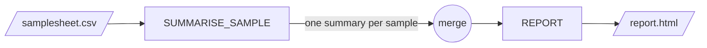

# subworkflow-template-nf

A minimal, working template for building modular [Nextflow](https://www.nextflow.io/) DSL2 pipelines.

It contains a small example analysis that you can run straight away, and shows the conventions to
follow when writing your own pipeline: one entry point, subworkflows, one file per process, central
configuration of resources and containers, and self-contained test profiles.

## Quick start

Requirements: Nextflow `>=22.10.0` and Docker (or Singularity).

```bash
nextflow run main.nf -profile test,docker
```

Results are written to `results/`. Open `results/report/report.html` to see the report.

## Repository structure

```
main.nf                       Entry point: validates parameters, reads the samplesheet, calls the subworkflow
workflows/
  example_workflow.nf         Subworkflow: connects the processes together (take / main / emit)
modules/
  summarise_sample.nf         Process: one task per sample
  report.nf                   Process: one task for all samples
bin/
  summarise_sample.R          Scripts called by the processes (automatically added to the PATH)
assets/
  report/                     Static files used by the pipeline (here, the report template and logo)
conf/
  base.config                 CPU / memory / time per process label, retry strategy
  containers.config           Container image of each process
  cloud-provider.config       Selects executor-specific settings automatically
  azurebatch.config           Azure Batch pools, one per resource label
  test.config                 'test' profile
  test_full.config            'test_full' profile
testdata/                     Small input data used by the test profiles
nextflow.config               Manifest, parameters, profiles and execution reports
```

## The example pipeline



1. **`SUMMARISE_SAMPLE`** runs once per sample, in parallel, and computes simple statistics
   (genes detected, total counts, top gene) from a table of gene counts.
2. The per-sample summaries are merged into a single table with `collectFile`.
3. **`REPORT`** renders an HTML report from the merged table using R Markdown.

### Input

`--input` is a CSV samplesheet with one row per sample:

```csv
sample,counts
sample_A,counts/sample_A.csv
sample_B,s3://my-bucket/data/sample_B.csv
```

| Column   | Description                                                                                         |
| -------- | --------------------------------------------------------------------------------------------------- |
| `sample` | Unique sample identifier                                                                            |
| `counts` | CSV file with the columns `gene` and `count`. Absolute paths and URIs (`s3://`, `az://`, ...) are used as they are; relative paths are resolved against the folder containing the samplesheet. |

### Parameters

| Parameter  | Default   | Description                              |
| ---------- | --------- | ---------------------------------------- |
| `--input`  | -         | Samplesheet (mandatory)                  |
| `--outdir` | `results` | Directory where the results are published |
| `--help`   | `false`   | Print the usage message and exit         |
| `--lifebit_platform_executor` | `local` | Executor used by the job. Set automatically by CloudOS (see [Executors](#executors)) |

### Output

```
results/
├── summaries/
│   └── <sample>.summary.csv       Per-sample summary
├── report/
│   └── report.html                HTML report with all samples
└── pipeline_info/
    ├── execution_report.html      Nextflow execution report
    ├── execution_timeline.html    Nextflow timeline
    └── execution_trace.txt        Resources used by each task
```

## Profiles

Profiles are combined with commas, e.g. `-profile test,docker`.

| Profile       | Description                                              |
| ------------- | -------------------------------------------------------- |
| `docker`      | Run the processes in Docker containers                   |
| `singularity` | Run the processes in Singularity containers              |
| `test`        | Minimal test with 2 samples                              |
| `test_full`   | Test with all 4 samples                                  |

When running on a cloud platform (e.g. AWS Batch or Azure Batch), the platform provides the
executor and container settings, so only the test profile is needed (e.g. `-profile test`).

### Executors

`conf/cloud-provider.config` applies executor-specific settings according to
`--lifebit_platform_executor`, which CloudOS sets automatically for each job:

| Executor     | Settings                                                                                        |
| ------------ | ----------------------------------------------------------------------------------------------- |
| `awsbatch`   | None needed: AWS Batch picks an instance that fits each task                                     |
| `azurebatch` | `conf/azurebatch.config`: one pool of fixed-size VMs per resource label (VM sizes configurable with `--azure_vm_type_low/medium/high`) |
| `local`, ... | None                                                                                            |

When adapting the template, rename the Azure pools after your pipeline: pools are shared by all
the pipelines of a Batch account.

### Why the test data is inside the repository

The test profiles only use files from `testdata/`. Nextflow stages these files to the work
directory itself, so the tests need no access to external buckets or websites and run the
same way locally, on AWS, on Azure, and in workspaces behind a firewall. The only external
resource is the container image, pulled from the configured container registry.

Keep test datasets small (a few MB at most) so this approach stays practical.

## Adapting the template to your pipeline

1. **Rename** the pipeline in `nextflow.config` (`manifest` block) and update this README.
2. **Write your processes** in `modules/`, one process per file. Give each one a resource
   label (`process_low`, `process_medium`, `process_high`) instead of hard-coded `cpus`/`memory`.
3. **Put helper scripts** in `bin/` and make them executable (`chmod +x`).
4. **Connect the processes** in a subworkflow in `workflows/`, receiving channels with `take:`
   and returning them with `emit:`. Avoid reading `params` inside processes where possible:
   pass values as inputs instead.
5. **Parse your inputs** in `main.nf` and pass them to the subworkflow as channels.
6. **Declare every parameter** with a default value in the `params` block of `nextflow.config`,
   and document it in `helpMessage()` in `main.nf` and in this README.
7. **Set the container** of each process in `conf/containers.config`. Always pin an explicit
   version tag and never use `latest`: workspaces that pull images through a registry mirror or
   proxy only resolve explicitly tagged images, and pinned tags make results reproducible.
8. **Replace the test data** in `testdata/` with a small dataset for your pipeline, and keep
   the `test` profiles working. Run `nextflow lint .` to check the code.

### Resources

Default resources per label are defined in `conf/base.config`. Tasks killed by the system (for
example out of memory, or a spot instance being reclaimed) are retried up to twice, with more
memory on each attempt. To change the resources of a single process without editing the
pipeline, pass a custom config with `-c`:

```groovy
// custom.config
process {
    withName: 'SUMMARISE_SAMPLE' {
        cpus   = 2
        memory = 4.GB
    }
}
```

```bash
nextflow run main.nf -profile test,docker -c custom.config
```

## Continuous integration

`.github/workflows/ci.yml` runs `nextflow lint` and both test profiles with Docker, on the oldest
supported and the latest Nextflow release.
